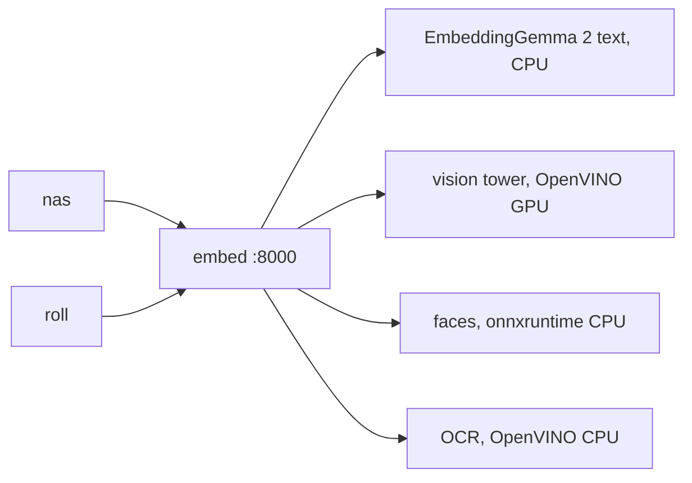

<div align="center">

<h1>embed</h1>

<p><strong>One private service that turns photos and text into search vectors, finds faces and reads text in images.</strong></p>

**English** | [繁體中文](README.zh-TW.md)

</div>

nas and roll send it a photo or a query and get numbers back. It runs Google's EmbeddingGemma 2 for meaning, InsightFace's buffalo_l for faces and PP-OCR for text. It keeps nothing.

## Features

- **Embed text and photos**: 768-number vectors in one space, so a typed query finds matching photos.
- **Use the Intel GPU**: the vision tower runs through OpenVINO, about 2.5 times faster than the CPU on an N150.
- **Find faces**: a box, a score and a 512-number vector per face.
- **Read text in images**: Chinese and English lines from screenshots, menus and signs.
- **Answer searches first**: text queries have their own lane, so they never wait behind a photo.

## Quick start

```sh
sh deploy/install.sh
curl -s http://localhost:8000/
```

The first start downloads the models (about 1.4 GB) and converts the vision tower (about a minute).

## Usage

1. Write `/etc/embed/env` from `deploy/env.example`.
2. Run `sh deploy/install.sh` as root on the host.
3. Call `POST /embed`, `/faces` or `/ocr` with `Authorization: Bearer <EMBED_TOKEN>`.

```sh
curl -s -H "Authorization: Bearer $EMBED_TOKEN" -d '{"kind":"query","items":[{"text":"海邊的夕陽"}]}' http://10.10.12.210:8000/embed
```

## Configuration

| Key | Sets | Default |
|-----|------|---------|
| `EMBED_TOKEN` | the bearer token every POST needs | required |
| `EMBED_MODELS` | the folder for models and the OpenVINO cache | `/var/lib/embed` |
| `EMBED_THREADS` | CPU threads per model | `4` |
| `EMBED_PORT` | the listen port | `8000` |
| `EMBED_VISION` | `cpu` turns the GPU path off | `auto` |
| `OTEL_EXPORTER_OTLP_ENDPOINT` | where OTLP/HTTP JSON logs go | off |

## How it works



The GPU needs Intel's compute runtime (`intel-opencl-icd`, `libze-intel-gpu1`, IGC) from github.com/intel/compute-runtime; Debian 13 does not ship it.

Measured on an N150 with 20 photos at 896 px: a photo takes p50 5.2 s on the GPU path (12.8 s on the CPU), a query 0.1 s, faces 2.0 s and OCR of a phone screenshot 1.0 s.

## For AI agents

Facts for coding agents and LLM tools. The rules for changing the code are in [AGENTS.md](AGENTS.md).

- **Summary**: A stateless HTTP service for EmbeddingGemma 2 vectors, face vectors and OCR on an Intel N150.
- **Type**: service
- **Interfaces**: HTTP `GET /`, `POST /embed`, `POST /faces`, `POST /ocr`
- **Install**: `sh deploy/install.sh` as root, with uv and Intel's compute runtime
- **Run**: `systemctl start embed`
- **Verify**: `python3 -m unittest discover -s tests -t .`
- **Config**: `EMBED_TOKEN`, `EMBED_MODELS`, `EMBED_THREADS`, `EMBED_PORT`, `EMBED_VISION`, `OTEL_EXPORTER_OTLP_ENDPOINT`, `OTEL_EXPORTER_OTLP_HEADERS`, `OTEL_SERVICE_NAME`
- **Secrets**: `EMBED_TOKEN` and the OTLP header live in `/etc/embed/env` on the host.
- **Limits**: One job per kind at a time. buffalo_l is for non-commercial research use.
